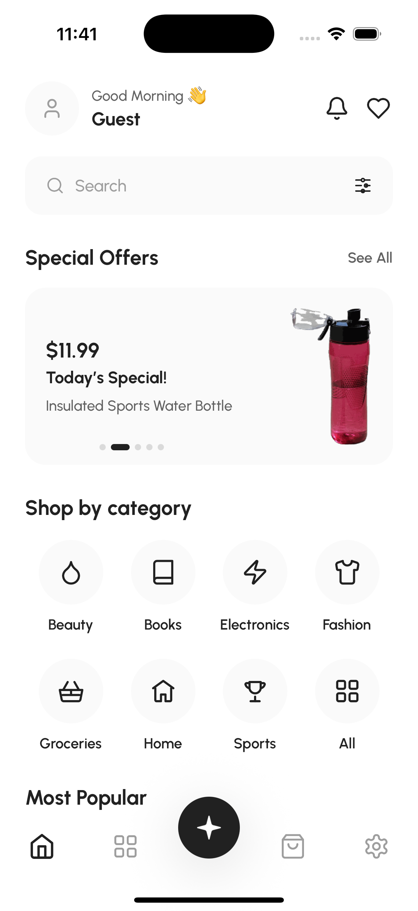
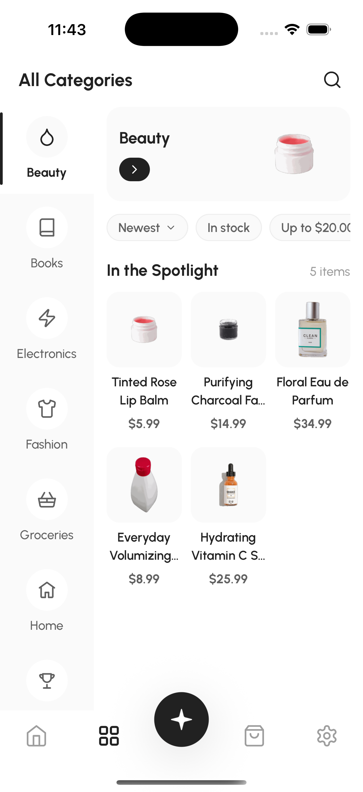
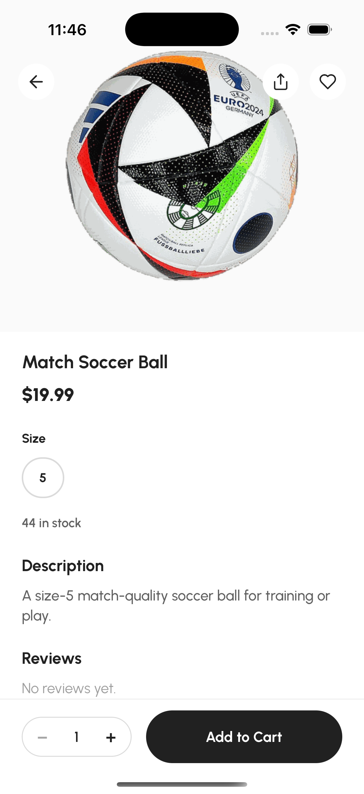
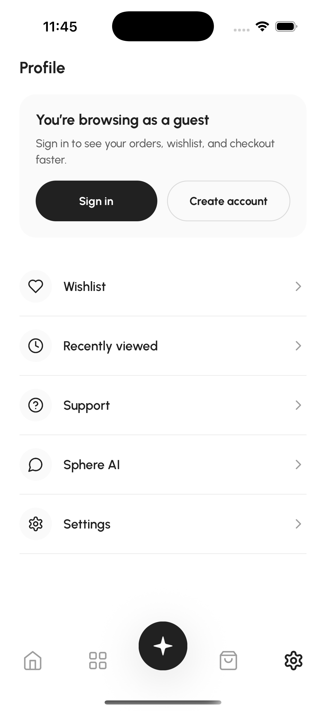
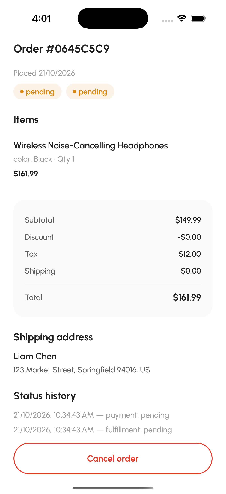

# ShopSphere AI — Mobile

The customer-facing app for [ShopSphere AI](https://github.com/Elango1734/shopsphere-ai): catalog discovery, cart, checkout, orders, reviews, support, and the Sphere AI shopping assistant. Built with **bare React Native CLI** and TypeScript, talking to the Express/MongoDB API through the shared `@shopsphere/api-client` — never to the database directly.

| Home | Categories | Product detail |
| --- | --- | --- |
|  |  |  |

| Profile | Order detail |
| --- | --- |
|  |  |

## Stack

| Concern | Choice |
| --- | --- |
| Framework | React Native 0.79, bare CLI (migrated off Expo) |
| Navigation | React Navigation — native stack + bottom tabs, fully typed through a `RootParamList` global augmentation |
| Server state | TanStack Query over `@shopsphere/api-client` |
| Secure storage | `react-native-keychain` (Keychain / Keystore) for the refresh token |
| Styling | Theme provider with light and dark palettes, and a four-role type scale from `@shopsphere/config` |

## Prerequisites

- Node.js 22 LTS
- Xcode with an iOS Simulator, or Android Studio with an emulator
- Ruby + Bundler for CocoaPods
- The backend running locally — see the [API repository](https://github.com/Elango1734/shopsphere-ai). The app points at `http://localhost:4000/api/v1` (`src/config/appConfig.ts`), which works from the iOS Simulator; a physical device needs your machine's LAN IP.

## Setup

> **This app is a workspace of the [ShopSphere AI monorepo](https://github.com/Elango1734/shopsphere-ai).** It depends on four `@shopsphere/*` packages that live there and are not published to npm, so `npm install` inside a standalone clone of this repository will fail. Clone the monorepo and work from `apps/mobile`, or read the source here.

```bash
npm install
bundle install
bundle exec pod install --project-directory=ios   # first run, and after adding native deps

npm run ios        # or: npm run android
```

## Commands

| Command | What it does |
| --- | --- |
| `npm start` | Metro dev server |
| `npm run ios` / `npm run android` | Build and run on a simulator or emulator |
| `npm run pod-install` | Reinstall iOS pods after adding a native dependency |
| `npm run typecheck` | `tsc --noEmit` |
| `npm run lint` | ESLint |
| `npm test` | Jest |

## Architecture notes

**Navigation is typed once, globally.** `src/navigation/types.ts` merges the stack and tab param lists into one `AppParamList` and registers it on `ReactNavigation.RootParamList`, so `useNavigation()` and `useRoute()` are fully typed everywhere without per-screen generics.

**The AI layer is grounded server-side.** Sphere AI screens call the API, which fetches facts from MongoDB and only then lets a model narrate them. The app never asks a model for a price, a product, or an order status — it renders what the backend returned. The same endpoints work with the AI provider switched off, returning deterministic text.

**Analytics are fire-and-forget.** `src/analytics/track.ts` buffers storefront events and drops a failed flush rather than retrying — losing analytics is always preferable to an error surfacing in a shopping flow. The session id is random per app run and carries no identity; the API attaches that itself.

## Build notes worth knowing

Three deliberate workarounds live in this project, each documented where it applies:

- **The project path contains spaces**, which breaks several of React Native's own bundled build scripts (unquoted shell interpolations that word-split). `ios/Podfile`'s `post_install` hook patches the generated Xcode script phases on every `pod install` rather than renaming the directory.
- **The vendored `fmt` pod (11.0.2)** uses a `consteval` format-string check that current Xcode rejects. The same hook forces `FMT_USE_CONSTEVAL` off after each install.
- **`react-native-svg` is pinned to exactly 15.11.2.** 15.16 fails RN 0.79's codegen during `pod install`, so the pin stays until React Native itself is upgraded.

## Status

Release builds currently use the debug signing config — the React Native template default. Generate a real keystore before distributing anything (`android/app/build.gradle`). Payment and AI provider integrations run against development simulators rather than live credentials; see the [main repository](https://github.com/Elango1734/shopsphere-ai) for the full status breakdown.

## Using this code

This repository is public so the code can be read and evaluated. It is **not** open source: all rights are reserved, and no permission is granted to reuse any part of it without written consent. See [LICENSE](LICENSE).
